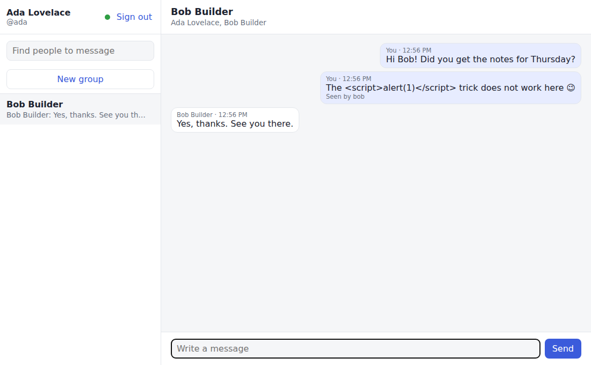

# Messenger

[](https://github.com/kartikey13kaushiq/messenger/actions/workflows/ci.yml)
 


A messaging service for direct and group conversations, with real-time delivery over WebSocket
(STOMP), read receipts, typing indicators and unread counts. It ships with a dependency-free
web client.



## Features

- **Direct and group conversations.** Exactly one direct conversation exists per pair of
  users, enforced by a unique key and a race-free `INSERT ... ON CONFLICT`. Groups have up to
  50 members, an owner who can rename and add people, and automatic owner hand-over when the
  owner leaves.
- **Ordered, gap-free history.** Every message gets a per-conversation sequence number
  (1, 2, 3, ...), assigned under a row lock. Sequence numbers drive cursor pagination
  (`?before=<seq>`), read markers and unread counts (`lastSeq - lastReadSeq`), so none of
  them needs a `COUNT(*)`.
- **Safe retries.** A send can carry a `clientMessageId`. Resending the same id returns the
  original message (`200`) instead of creating a duplicate (`201`).
- **Edit and delete.** Senders can edit a message within 15 minutes. Deletes are soft: the
  slot and its sequence number stay, so history and unread counts remain consistent.
- **Real time.** Events are pushed to `/user/queue/events` only after the database
  transaction commits, so clients never see state that was rolled back. Event types are
  `message.created`, `message.updated`, `message.deleted`, `conversation.created`,
  `conversation.updated`, `member.left`, `read` and `typing`.
- **Security.**
  - BCrypt passwords, and login failures that look identical whether or not the user exists.
  - Short-lived HS256 JWTs.
  - The STOMP `CONNECT` frame is authenticated, and subscriptions are limited to the user's
    own queues.
  - Membership is checked on every call. A conversation you are not in is a `404`, not a
    `403`, so its existence does not leak.
  - A strict Content-Security-Policy (`script-src 'self'`). The web client renders all user
    text with `textContent`.
- **Errors** are [RFC 9457](https://www.rfc-editor.org/rfc/rfc9457) problem details with a
  stable `code`, plus a `fields` map for validation errors.

## Architecture

```mermaid
sequenceDiagram
    participant A as Ada (browser)
    participant S as Messenger
    participant DB as PostgreSQL
    participant B as Bob (browser)
    B->>S: STOMP CONNECT (Bearer token), SUBSCRIBE /user/queue/events
    A->>S: POST /api/conversations/{id}/messages {body, clientMessageId}
    S->>DB: SELECT ... FOR UPDATE conversation; seq = lastSeq + 1; INSERT message
    DB-->>S: commit
    S-->>A: 201 message
    S--)B: message.created (after commit)
    B->>S: POST /api/conversations/{id}/read {seq}
    S--)A: read {username: bob, seq}
```

```
src/main/java/.../messenger
  user/       registration, login, profile, user search
  chat/       conversations, membership, messages (entities, repositories, services, REST controllers)
  realtime/   STOMP config + CONNECT/SUBSCRIBE authorisation, after-commit event delivery, typing relay
  config/     security, JWT, OpenAPI, clock
  error/      problem-detail exceptions and handler
src/main/resources
  db/migration/   Flyway schema
  static/         web client (HTML, CSS, vanilla JS, vendored STOMP.js)
```

## Run it

```bash
docker compose up --build                    # app + PostgreSQL on http://localhost:8080
```

For development:

```bash
docker compose up -d postgres
./mvnw spring-boot:run -Dspring-boot.run.profiles=dev
```

Open http://localhost:8080 in two browser windows (one private), register two users, and
message each other. The API is documented at http://localhost:8080/swagger-ui.html.

| Variable | Default | |
|---|---|---|
| `DATABASE_URL`, `DATABASE_USERNAME`, `DATABASE_PASSWORD` | `jdbc:postgresql://localhost:5432/messenger` | PostgreSQL |
| `JWT_SECRET` | required (a dev default exists in the `dev` profile) | HS256 key, at least 32 bytes |
| `JWT_TTL` | `PT12H` | Access token lifetime |
| `WS_ALLOWED_ORIGINS` | `*` | Allowed WebSocket origins (comma-separated patterns) |

## API

| | |
|---|---|
| `POST /api/auth/register`, `POST /api/auth/login` | Account and bearer token |
| `GET/PATCH /api/users/me`, `GET /api/users?q=` | Profile, people search |
| `GET /api/conversations` | Your conversations, most recent first, with last message and unread count |
| `POST /api/conversations/direct` `{username}` | Open (or create) the direct conversation |
| `POST /api/conversations/groups` `{title, members[]}` | Create a group |
| `GET/PATCH /api/conversations/{id}` | Details, rename (owner) |
| `POST /api/conversations/{id}/members`, `DELETE .../members/me` | Add (owner), leave |
| `POST /api/conversations/{id}/read` `{seq}` | Move your read marker forward |
| `GET /api/conversations/{id}/messages?before=&limit=` | Page of history, oldest first, with `nextBefore` cursor |
| `POST /api/conversations/{id}/messages` `{body, clientMessageId?}` | Send |
| `PATCH/DELETE /api/conversations/{id}/messages/{messageId}` | Edit (15 min), delete |

WebSocket: connect STOMP to `/ws` with the header `Authorization: Bearer <token>`, then
subscribe to `/user/queue/events`. Send typing signals to
`/app/conversations/{id}/typing`.

## Tests

```bash
./mvnw verify          # 22 integration tests + JaCoCo gate (80% line coverage; currently ~96%)
```

The tests boot the whole service on a random port, with PostgreSQL from **Testcontainers**
(or an existing database via `TEST_DATABASE_URL`). They cover:

- 20 concurrent senders get exactly the sequence numbers 1–20.
- 8 concurrent "open direct chat" calls create one conversation.
- Retried sends are deduplicated.
- Cursor pagination, the edit window (using a controllable clock), soft deletes, group
  ownership hand-over, and outsider isolation.
- Real STOMP clients receive events, read receipts and typing indicators. Unauthenticated
  connections and foreign subscriptions are refused.

## Scaling notes

The service is stateless apart from WebSocket sessions. With more than one instance, replace
the in-memory simple broker with a STOMP broker relay (RabbitMQ or ActiveMQ), so that an event
produced on one node reaches users connected to another. The change is confined to
`WebSocketConfig`.

## License

[MIT](LICENSE)
